# FMLab

Foundation models learn general representations through pretraining on large datasets and adapt them to downstream tasks. The approach developed in natural language processing (NLP), with models such as LLaMA, BERT, and GPT, and is now being applied to time series for classification, anomaly detection, forescasting and trend analysis. However time series data hold information that can be represented across different modalities such as scalogram images, which open the possibility of computer vision models to be used as well. This research is centered on studying the potential of LeJEPA in comparison with generalist and domain specific time series foundation models when dealing with physiological signals, specifically in downstreams tasks related to cognitive state estimation. 

The **hypothesis** is that LeJEPA can extract representations useful for physiological classification from scalograms, even though it was not pretrained on them. Its performance depends on whether the CWT captures signal patterns relevant to the downstream task, and may vary with the choice of wavelet and other transformation settings.

> **IMPORTANT:** This is an exploratory study intended to inform future work on LeJEPA models for time series. The image-based approach has limitations: e.g., a longer context window must be represented within the same fixed-size model input, which can make fine temporal patterns harder to distinguish.

## Introduction

### Foundation models and LeJEPA

Foundation models learn general representations through pretraining on large datasets and adapt them to downstream tasks. The approach developed in natural language processing (NLP), with models such as LLaMA, BERT, and GPT, and is now being applied to time series for classification, anomaly detection, forecasting and trend analysis.

[LeJEPA](https://arxiv.org/abs/2511.08544) is a self-supervised learning approach based on joint embedding predictive architectures. It learns representations by encouraging agreement between different views of the same input and uses Sketched Isotropic Gaussian Regularization (SIGReg) to prevent the representations from collapsing to a constant. This approach has shown competitive performance on image benchmarks, while the related [LeVJEPA](https://arxiv.org/abs/2608.27395) extends the objective to video. LeVJEPA is an inspiration for this research because both video and time-series data have a temporal dimension.

The CWT provides a bridge between the time series and visual domains by representing the signal as a scalogram, where changes over time and frequency can be observed in an image. The choice of wavelet, frequency range, and window length determines which signal dynamics are presented to the visual encoder. An [image-pretrained LeJEPA vision transformer](https://huggingface.co/OK-AI/lejepa-vits16-pretrain-in1k) can therefore provide an initial way to explore time-series representations without first training a new encoder. This is a proxy for the research direction: it measures the transfer of an existing image model through a chosen representation, rather than directly evaluating a LeJEPA model pretrained on time series.

Previous work has considered CWT scalograms as a way to represent time-varying frequency information in images suitable for computer vision models. A [study using CWT scalograms](https://link.springer.com/article/10.1007/s10278-026-02417-w) highlights how this representation brings temporal and frequency information together, making it possible to process time series with image architectures.

The CWT also allows different representations to be explored without retraining the pretrained LeJEPA model, even though it was not originally trained on scalogram images. Different wavelets can emphasize different patterns and may provide alternative views for future fine-tuning. The present comparison uses a fixed wavelet configuration and a trained downstream classifier, so it does not test wavelet augmentation or zero-shot classification. It can instead serve as an initial baseline against which future time-series LeJEPA models and transformation choices may be compared.

### Physiological signals

Physiological time series provide a setting for studying these representations because the same types of signals can support different tasks in clinical and wearable settings. The difficulty depends on the relationship between the signal and the task: a pattern may be distinguishable across participants for one outcome, while differences between participants make another outcome harder to estimate. This makes it possible to study representation learning across tasks with different requirements. For example, cognitive state estimation can be difficult because labels may rely on self-reports or experimental conditions, while physiological responses vary between participants. Public datasets cover tasks such as stress detection, engagement, and sleep stages, providing different settings in which to evaluate a model.

In this research, we explore whether an image-pretrained LeJEPA model can extract useful representations from physiological time series converted into scalograms. We compare its representations with those from generalist and domain-specific time-series foundation models, beginning with stress classification. The comparison provides an initial baseline for possible future LeJEPA models designed directly for time series.

## Experiments

**Dataset**. We use the [WESAD dataset](https://ubi29.informatik.uni-siegen.de/usi/data_wesad.html), a multimodal dataset collected from 15 participants during a laboratory study on stress and affect detection. The dataset includes physiological and motion signals from chest-worn and wrist-worn devices. For this research, we use the electrocardiogram (ECG) recorded by the chest-worn device and focus on the baseline and stress conditions as a binary classification task.

The chest ECG was originally sampled at 700 Hz and is downsampled to 256 Hz. For each participant and condition, the signal is divided into non-overlapping windows of 2 seconds. These windows are used as the common dataset for all models, with labels identifying the baseline and stress conditions.

**Embedding Models**. We tried these models:

- **[Chronos-T5 base](https://arxiv.org/abs/2403.07815):** Scales and quantizes input values into tokens processed by a Transformer. We average the encoder outputs across the sequence to obtain one embedding per window.

- **[MOMENT-1-large](https://proceedings.mlr.press/v235/goswami24a.html):** Divides the input into patches and processes them with a Transformer encoder. We use it in embedding mode.

- **[NormWear](https://arxiv.org/abs/2412.09758):** Applies the CWT with a Ricker wavelet to the original signal and its first and second differences. The resulting time-frequency representations are divided into patches and processed by a Vision Transformer encoder. Its encoder blocks use self-attention and feed-forward networks, with fusion blocks sharing information between sensor channels. The final classification token provides the signal embedding.

- **[TS-JEPA](https://arxiv.org/abs/2509.25449):** Applies a joint embedding predictive architecture to time series, learning representations by predicting masked parts of a signal from its visible context. We use the last 320 samples of each window as 10 patches of 32 samples, and sum the encoder outputs across patches to obtain the embedding.

- **[LeJEPA ViT-S/16](https://huggingface.co/OK-AI/lejepa-vits16-pretrain-in1k) (complex Morlet, `cmor1.5-1.0`):** Each window is converted into a scalogram using the CWT with 100 frequencies between 1 and 65 Hz. The resulting image is passed to the encoder to obtain an embedding.

**Evaluation Protocols**. We use leave-k--out (k = 3) cross validation through the participants. a logistic regression classifier is trained on embeddings from the remaining participants and evaluated separately for each held-out participant.

The participant split tests transfer to participants excluded from the downstream classifier's training data. It does not by itself establish that the evaluation data were absent from the models' original pretraining corpora. [Research on time-series foundation model evaluation](https://arxiv.org/abs/2510.13654) highlights pretraining overlap and related forms of information leakage as risks for benchmarking; this is a consideration when interpreting results for pretrained checkpoints whose data provenance is not fully known.

- **Linear probing:** The classifier is trained using all available training embeddings. We evaluate accuracy, balanced accuracy, macro F1, Matthews correlation coefficient, and AUROC for each participant.

- **Data scarcity:** The classifier is trained using 1%, 5%, 10%, 25%, 50%, or 100% of the training samples from each class. Sampling is repeated with three seeds, and balanced accuracy and AUROC are averaged across seeds for each participant.

- **Noise stress:** The classifier is trained on clean embeddings and evaluated on clean signals and signals with added Gaussian noise at 0, 10, and 20 dB signal-to-noise ratios. Noisy signals are embedded again before evaluation. Three noise realizations are used, and balanced accuracy and AUROC are averaged across seeds for each participant.

### Results

Results are reported as mean ± sample standard deviation across the 15 participant groups. For data scarcity and noise stress, each participant's score is first averaged across the three seeds; the tables report AUROC.

**Linear probing**. Chronos achieves the highest mean AUROC and balanced accuracy. LeJEPA with the complex Morlet wavelet has an AUROC close to NormWear's, while its balanced accuracy is higher.

| Model | AUROC | Balanced accuracy | Accuracy | Macro F1 | MCC |
|---|---:|---:|---:|---:|---:|
| Chronos-T5 base | 0.883 ± 0.134 | 0.779 ± 0.165 | 0.780 ± 0.178 | 0.749 ± 0.198 | 0.585 ± 0.296 |
| MOMENT-1-large | 0.839 ± 0.192 | 0.744 ± 0.187 | 0.752 ± 0.194 | 0.713 ± 0.217 | 0.515 ± 0.358 |
| LeJEPA ViT-S/16 (complex Morlet) | 0.826 ± 0.154 | 0.729 ± 0.148 | 0.734 ± 0.155 | 0.705 ± 0.170 | 0.474 ± 0.279 |
| NormWear | 0.820 ± 0.187 | 0.678 ± 0.152 | 0.669 ± 0.166 | 0.627 ± 0.189 | 0.383 ± 0.294 |
| TS-JEPA | 0.749 ± 0.243 | 0.670 ± 0.154 | 0.692 ± 0.140 | 0.629 ± 0.183 | 0.356 ± 0.311 |

**Data scarcity**. Chronos has the highest mean AUROC at each tested fraction, reaching 0.842 with 1% of the training samples per class and 0.882 with all training data. LeJEPA with the complex Morlet wavelet reaches 0.803 at 1% and 0.817 at 5%. TS-JEPA shows the largest increase between 1% and 100%, from 0.576 to 0.749. Performance does not increase monotonically for every model.

| Model | 1% | 5% | 10% | 25% | 50% | 100% |
|---|---:|---:|---:|---:|---:|---:|
| Chronos-T5 base | 0.842 ± 0.116 | 0.853 ± 0.123 | 0.847 ± 0.145 | 0.863 ± 0.134 | 0.872 ± 0.132 | 0.882 ± 0.135 |
| MOMENT-1-large | 0.791 ± 0.241 | 0.795 ± 0.240 | 0.806 ± 0.239 | 0.825 ± 0.216 | 0.828 ± 0.206 | 0.839 ± 0.192 |
| LeJEPA ViT-S/16 (complex Morlet) | 0.803 ± 0.150 | 0.817 ± 0.158 | 0.804 ± 0.184 | 0.801 ± 0.185 | 0.811 ± 0.173 | 0.826 ± 0.154 |
| NormWear | 0.749 ± 0.165 | 0.799 ± 0.165 | 0.806 ± 0.173 | 0.814 ± 0.180 | 0.822 ± 0.182 | 0.820 ± 0.187 |
| TS-JEPA | 0.576 ± 0.092 | 0.675 ± 0.192 | 0.703 ± 0.211 | 0.732 ± 0.228 | 0.742 ± 0.236 | 0.749 ± 0.243 |

**Noise stress**. At 0 dB, NormWear has the highest mean AUROC (0.743), followed by TS-JEPA (0.619), LeJEPA with the complex Morlet wavelet (0.610), MOMENT (0.579), and Chronos (0.532). Chronos falls from 0.883 on clean data to 0.532 at 0 dB, while NormWear falls from 0.820 to 0.743.

| Model | Clean | 20 dB | 10 dB | 0 dB |
|---|---:|---:|---:|---:|
| Chronos-T5 base | 0.883 ± 0.134 | 0.789 ± 0.176 | 0.636 ± 0.127 | 0.532 ± 0.085 |
| MOMENT-1-large | 0.839 ± 0.192 | 0.835 ± 0.195 | 0.801 ± 0.193 | 0.579 ± 0.150 |
| LeJEPA ViT-S/16 (complex Morlet) | 0.826 ± 0.154 | 0.787 ± 0.171 | 0.720 ± 0.198 | 0.610 ± 0.121 |
| NormWear | 0.820 ± 0.187 | 0.809 ± 0.193 | 0.778 ± 0.195 | 0.743 ± 0.166 |
| TS-JEPA | 0.749 ± 0.243 | 0.733 ± 0.234 | 0.675 ± 0.189 | 0.619 ± 0.132 |

Scores vary substantially between participants, and these results are descriptive rather than evidence of statistical significance. They are limited to the selected dataset, preprocessing, and model checkpoints.

Together, these experiments provide a baseline for further investigation rather than a direct test of a time-series LeJEPA pretraining objective. The models differ in architecture, pretraining data, objectives, and input representation, so this comparison cannot attribute the observed differences to any one of them. A future model trained directly on time series could be evaluated against this image-based LeJEPA baseline under matched downstream settings.

## Appendix

### Evaluation figures

**Linear probing**

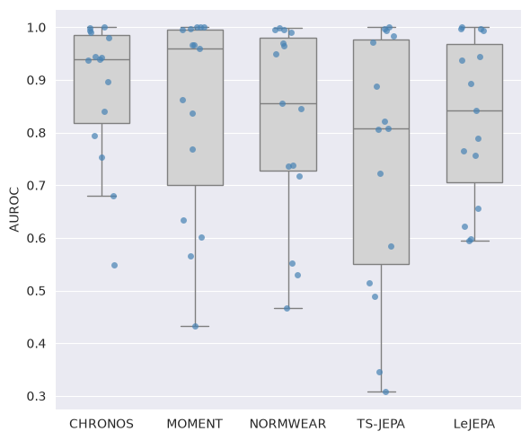

*Figure 1. Distribution of participant AUROC scores for linear probing across models.*

**Data scarcity**

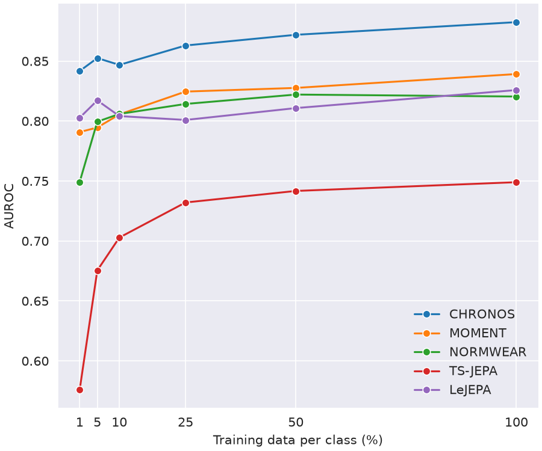

*Figure 2. Mean participant AUROC at each percentage of training data per class.*

**Noise stress**

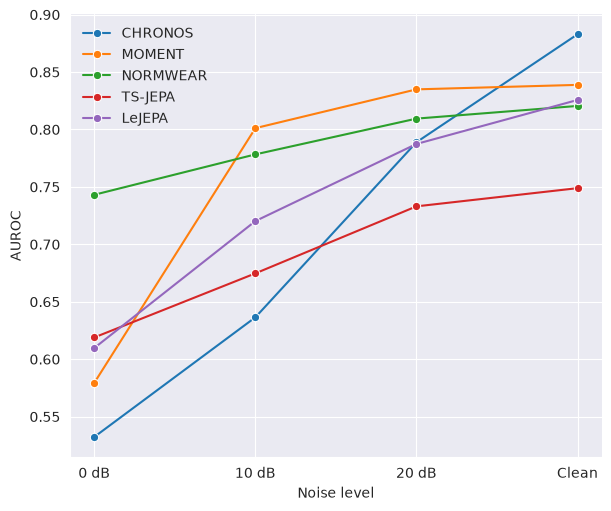

*Figure 3. Mean participant AUROC for clean signals and each noise level.*

### t-SNE visualizations

<table>
<tr>
<td>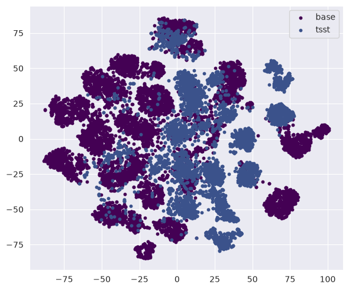</td>
<td>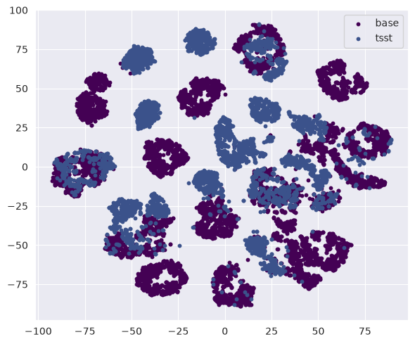</td>
<td>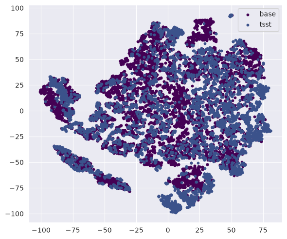</td>
<td>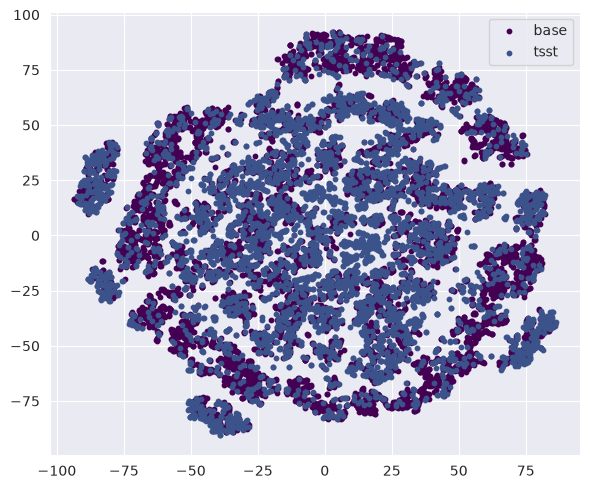</td>
<td>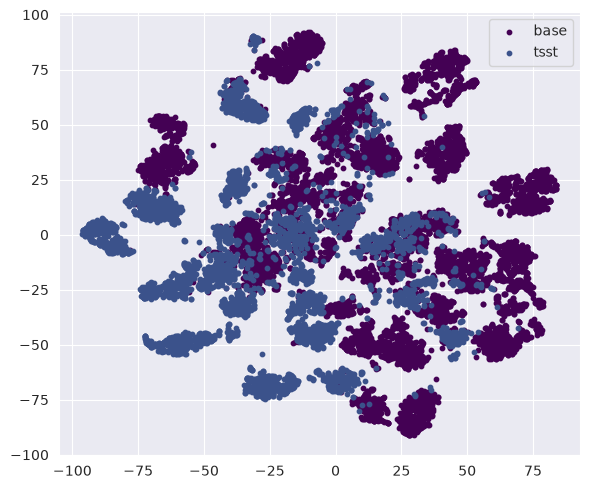</td>
</tr>
</table>

*Figure 4. t-SNE projections of embeddings for Chronos-T5 base, MOMENT-1-large, NormWear, TS-JEPA, and LeJEPA ViT-S/16 with complex Morlet, from left to right. Colors indicate the baseline and stress conditions.*

<table>
<tr>
<td></td>
<td>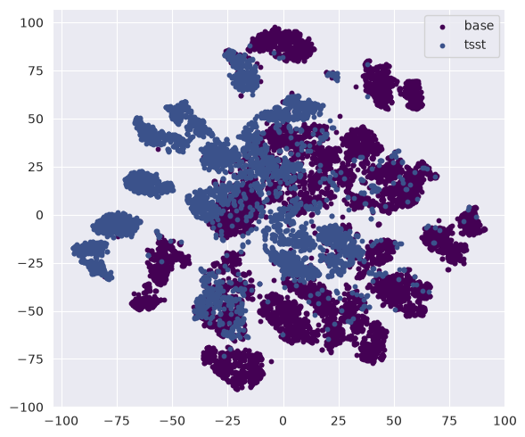</td>
<td>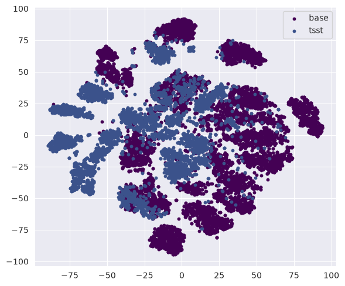</td>
<td>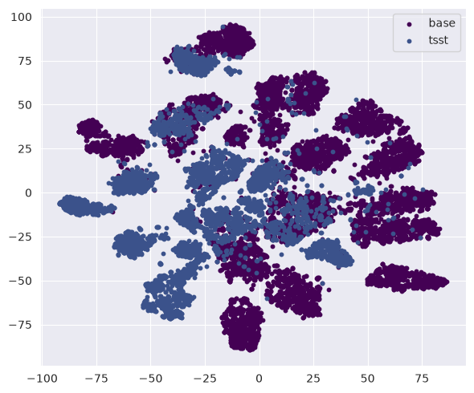</td>
</tr>
</table>

*t-SNE projections of LeJEPA embeddings using complex Morlet, Morlet, Mexican hat, and gaus1 wavelets, from left to right. Colors indicate the baseline and stress conditions.*

### Wavelet visualizations

<table>
<tr>
<td>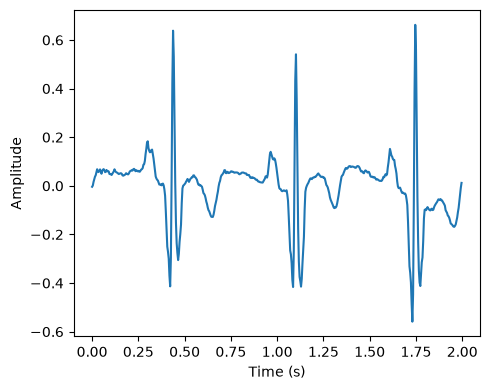</td>
<td>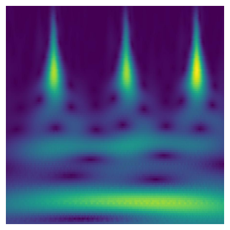</td>
<td>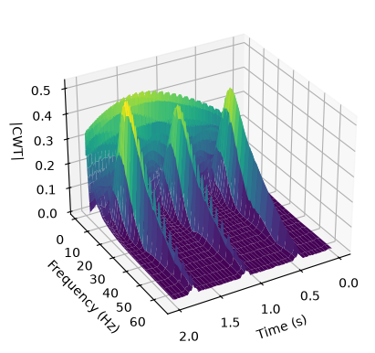</td>
</tr>
</table>

*Figure 5. Baseline window: original signal, complex Morlet scalogram, and CWT magnitude surface, from left to right.*

<table>
<tr>
<td>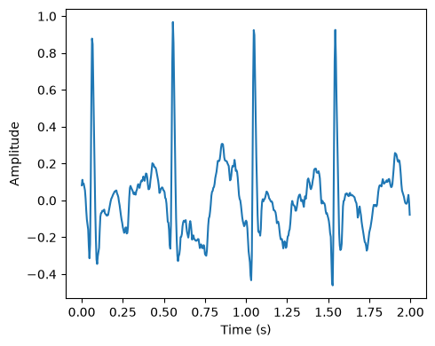</td>
<td>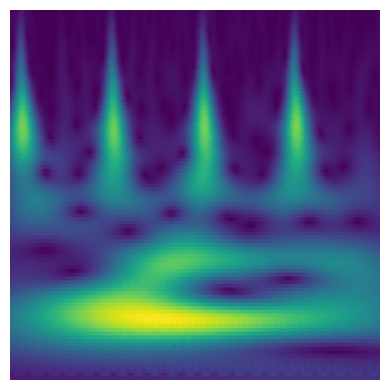</td>
<td>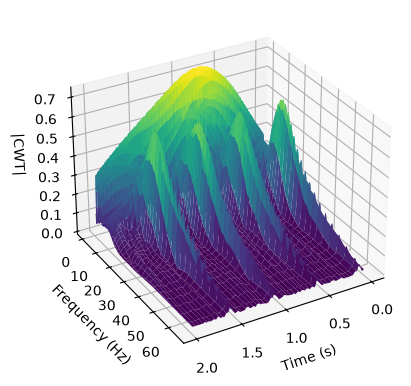</td>
</tr>
</table>

*Figure 6. TSST window: original signal, complex Morlet scalogram, and CWT magnitude surface, from left to right.*

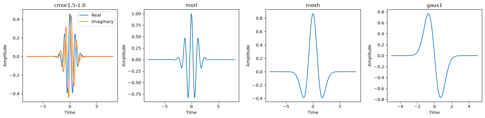

*Mother wavelets: complex Morlet, Morlet, Mexican hat, and gaus1, from left to right.*

Can different wavelets be used for data augmentation during fine-tuning? Different wavelets can emphasize different time-frequency patterns in the same signal, providing multiple views of each training window.

<table>
<tr>
<td></td>
<td>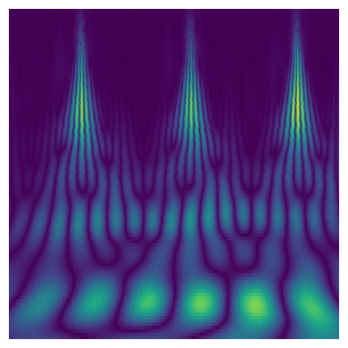</td>
<td>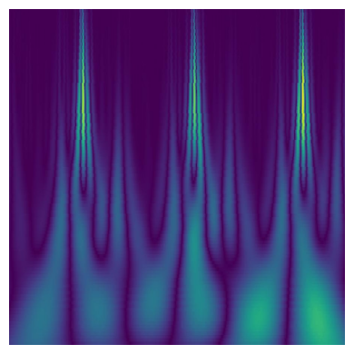</td>
<td>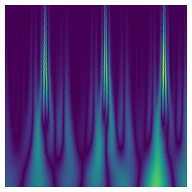</td>
</tr>
</table>

*Figure 7. Scalograms of the baseline window using complex Morlet, Morlet, Mexican hat, and gaus1 wavelets, from left to right.*

<table>
<tr>
<td></td>
<td>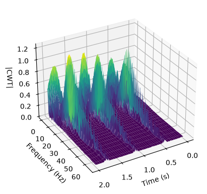</td>
<td>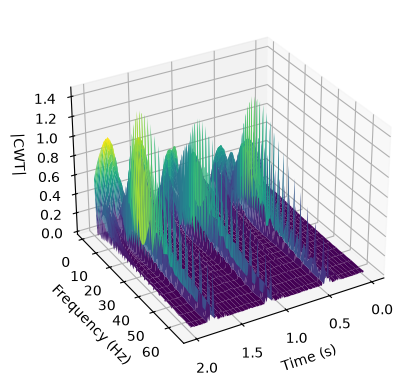</td>
<td>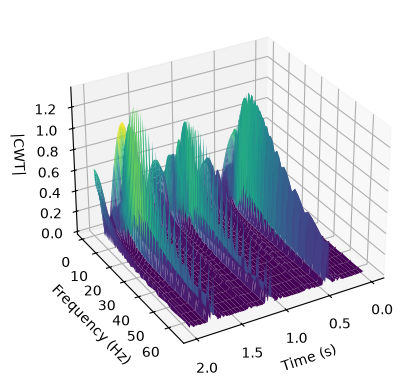</td>
</tr>
</table>

*CWT magnitude surfaces of the baseline window using complex Morlet, Morlet, Mexican hat, and gaus1 wavelets, from left to right.*

<table>
<tr>
<td></td>
<td>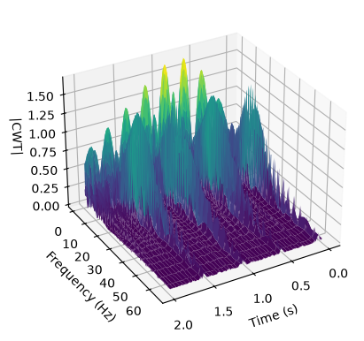</td>
<td>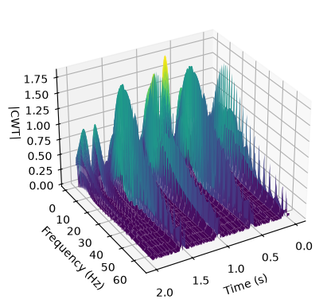</td>
<td>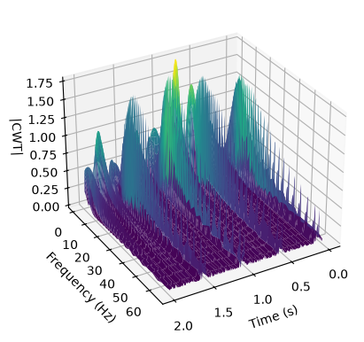</td>
</tr>
</table>

*CWT magnitude surfaces of the TSST window using complex Morlet, Morlet, Mexican hat, and gaus1 wavelets, from left to right.*
